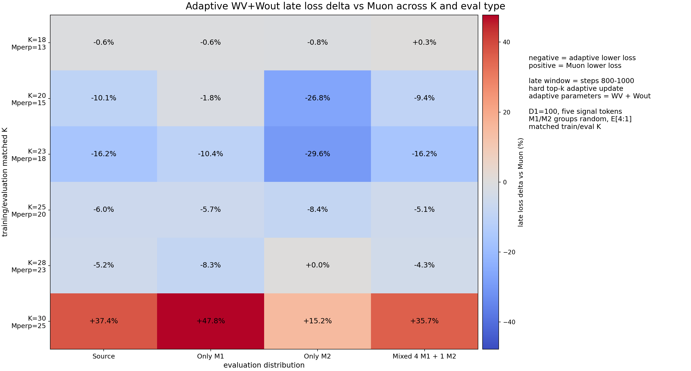

# Adaptive Muon for Sparse Attention Regression

This repository contains a compact, reproducible version of the sparse
attention experiments developed in the larger `muon_project` workspace. It
focuses on one question:

> When useful signal directions are sparse, can hard-top-k Adaptive Muon on
> the value/readout matrices suppress nuisance directions more effectively
> than full Muon?

## Focused result

Experiment 202 fixes five distinct signal tokens per sample and increases
sequence length `K`, so only the number of orthogonal Mperp tokens changes.
The comparison is:

- **Muon**: full-rank Muon on `WQ`, `WK`, `WV`, and `Wout`.
- **Adaptive WV+Wout**: full-rank Muon on `WQ/WK`; hard-top-k Adaptive Muon on
  `WV/Wout`.

The seed-0 sweep found the strongest adaptive gains at intermediate K:

| K | Mperp | Source | Only M1 | Only M2 | Mixed |
|---:|---:|---:|---:|---:|---:|
| 18 | 13 | -0.62% | -0.59% | -0.82% | +0.33% |
| 20 | 15 | -10.06% | -1.82% | -26.82% | -9.43% |
| 23 | 18 | -16.22% | -10.41% | -29.56% | -16.25% |
| 25 | 20 | -5.96% | -5.68% | -8.43% | -5.10% |
| 28 | 23 | -5.19% | -8.32% | +0.00% | -4.32% |
| 30 | 25 | +37.39% | +47.76% | +15.21% | +35.72% |

Negative means Adaptive WV+Wout has lower step-800-1000 mean loss. This is a
seed-0 mechanism result, not a statistically established transition point.



## Model

```text
Q = X WQ
K_att = X WK
A = softmax(Q K_att^T / sqrt(d_qk))
X_tilde = A X
V = ReLU(X_tilde WV)
h = sum_tokens(V)
y_hat = h Wout^T
loss = 0.5 * mean_batch ||y_hat - y||_2^2
```

See [docs/EXPERIMENT_202.md](docs/EXPERIMENT_202.md) for the complete data
model, optimizer, dimensions, and evaluation protocol. See
[docs/CODE_MAP.md](docs/CODE_MAP.md) for how the original numbered scripts were
reorganized into this standalone package.

For the formal mathematical specification, use:

- [Experiment 202 data and network](docs/EXPERIMENT_202_SETUP.md)
- [Rendered PDF](docs/EXPERIMENT_202_SETUP.pdf)

## Install

```bash
python -m venv .venv
source .venv/bin/activate
pip install -e .
```

## Reproduce experiment 202

Check GPU availability first:

```bash
nvidia-smi
```

Preview the 12 tasks:

```bash
muon-sweep --plan
```

Run the complete sweep and generate plots:

```bash
muon-sweep \
  --output outputs/experiment_202 \
  --gpus 0,1,2,3,4,5,6,7 \
  --jobs-per-gpu 2 \
  --eval-every 1
```

Each run evaluates 5,000 held-out examples at every step to match the original
protocol. For a faster development pass, use `--eval-every 10`.

Run one configuration:

```bash
muon-train \
  --K 23 \
  --method adaptive_wv_wout \
  --output outputs/K23/adaptive_wv_wout
```

Regenerate plots from completed runs:

```bash
muon-plot --input outputs/experiment_202
```

## Repository layout

```text
src/muon_sparse_attention/
  config.py   experiment configuration
  data.py     sparse signal and Mperp data model
  model.py    attention regression network
  optim.py    full and hard-top-k Adaptive Muon
  train.py    single-run trainer and evaluator
  sweep.py    multi-GPU experiment-202 launcher
  plot.py     CSV summaries and non-overlapping plots
docs/
  EXPERIMENT_202.md
results/experiment_202/
  selected result table and figures from the original workspace
tests/
  test_core.py
```

## Tests

```bash
python -m unittest discover -s tests -v
```
